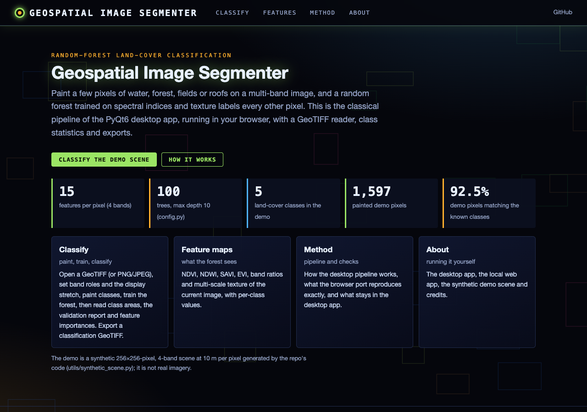
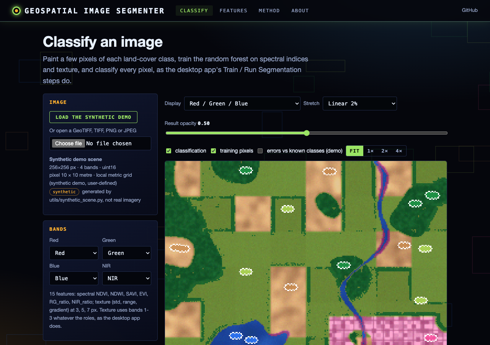
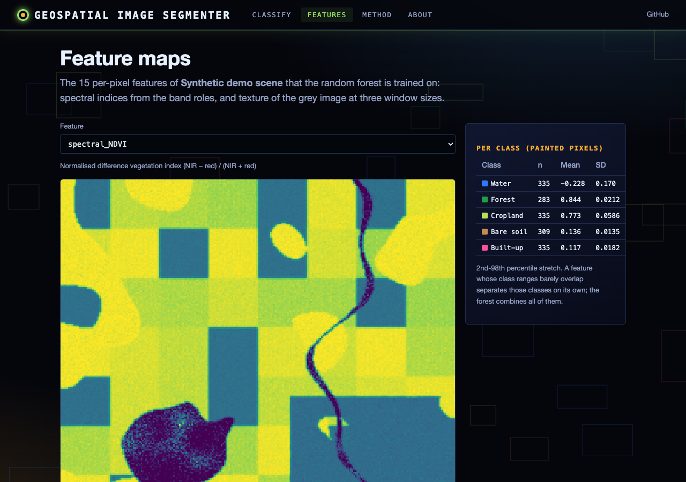

# Geospatial Image Segmentation Tool

A Python-based desktop application for segmenting and classifying geospatial imagery using machine learning. This tool provides an interactive interface for working with satellite imagery, aerial photography, and LIDAR data, allowing users to create training data, train models, and perform segmentation/classification tasks.

## Features

- **Multi-layer Support**
  - Raster layers (GeoTIFF, etc.)
  - Vector layers (Shapefile, GeoJSON)
  - LIDAR point clouds (LAS/LAZ)
  - OpenStreetMap and other base maps

- **Interactive Training Data Creation**
  - Paint-based interface for pixel selection
  - Multiple label support with custom colors
  - Real-time visualization of training areas

- **Advanced Analysis**
  - Spectral index calculation (NDVI, NDWI, etc.)
  - Texture feature extraction
  - Terrain analysis for elevation data

- **Machine Learning Integration**
  - Random Forest classifier
  - Convolutional Neural Networks (CNN)
  - Custom feature extraction pipeline

## Installation

1. Clone the repository:
```bash
git clone https://github.com/gddickinson/geospatial_image_segmenter.git
cd geospatial_image_segmenter
```

2. Create a virtual environment (recommended):
```bash
python -m venv venv
source venv/bin/activate  # On Windows: venv\Scripts\activate
```

3. Install the package and its dependencies (this also adds a `geo-segmenter` command that starts the app):
```bash
pip install -e .
```
   PDAL is optional (only LIDAR ground classification uses it) and cannot be installed with pip; if you need it,
   install it from conda-forge:
```bash
conda install -c conda-forge pdal python-pdal
```

## Dependencies

- Python 3.8+
- PyQt6
- NumPy
- Rasterio
- Geopandas
- Scikit-learn
- PyTorch (for CNN models)
- GDAL

## Usage

1. Launch the application:
```bash
geo-segmenter        # or, from the repository: python main.py
```

2. Import data:
   - Use File > Import to load raster, vector, or LIDAR data
   - Supported formats include GeoTIFF, Shapefile, LAS/LAZ
   - To try it out, `test_data/sample.tif` is a synthetic 3-band GeoTIFF (regenerate with
     `python scripts/make_sample_data.py`; see [DATA_SOURCES.md](DATA_SOURCES.md))

3. Create training data:
   - Enable training mode from the toolbar
   - Open the Label Manager
   - Create labels and assign colors
   - Hold Shift + Left Click to paint training areas

4. Train models:
   - Select desired model type (Random Forest/CNN)
   - Configure model parameters
   - Start training

5. Perform segmentation:
   - Apply trained model to new areas
   - Export results in various formats

## Project Structure

```
geo_segmenter/
├── data/                 # Data handling modules
│   ├── layer.py         # Base layer classes
│   └── providers/       # Data providers
├── gui/                 # User interface components
│   ├── dialogs/        # Dialog windows
│   ├── main_window.py  # Main application window
│   └── map_canvas.py   # Map display widget
├── models/             # Machine learning models
│   ├── base.py        # Base model interface
│   ├── random_forest.py
│   └── cnn.py
├── utils/             # Utility functions
│   ├── geo_utils.py
│   └── image_utils.py
├── web/              # web interface (see below)
└── ../main.py        # Application entry point (repo root)
```

## Web interface and static site

**Live site:** https://gddickinson.github.io/geospatial_image_segmenter/ (published by `.github/workflows/pages.yml`
on every push to `main`).

The classical pipeline of the desktop app (spectral indices + texture features, random forest) also runs in the
browser: open a GeoTIFF (strips or tiles, chunky or planar, 8-64-bit, LZW/Deflate/PackBits) or a PNG/JPEG, set the band
roles and display stretch, paint training pixels for each class, train and classify, then read class areas (hectares
from the GeoTIFF pixel size), the validation report and feature importances, and export a classification GeoTIFF
(georeferencing kept), an overlay PNG, a class-statistics CSV or the training pixels. The demo is a **synthetic**
scene generated by `geo_segmenter/utils/synthetic_scene.py` (not real imagery).

| Home | Classify | Feature maps |
|---|---|---|
|  |  |  |

### Run the web app
```bash
pip install -r requirements-web.txt
python run_web.py          # http://127.0.0.1:8235
```
The local app adds a Python engine (the repo's own `RandomForestModel` via `POST /api/classify`); the static site uses
the JS port. The JS feature extractors and display stretch are tested against the Python code (node tests on fixtures
from `scripts/make_web_fixtures.py`), and the demo's Python forest evaluated in JS reproduces the Python
classification on every pixel. The CNN, terrain features, LIDAR, vector layers and base maps stay in the desktop app.

```bash
python -m pytest -q tests                 # all tests (GUI test offscreen, skipped without the desktop deps)
python scripts/build_static.py            # static site in site/
python scripts/screenshots.py --static "" classify features method about
```

## Contributing

Contributions are welcome! Please feel free to submit a Pull Request.

1. Fork the repository
2. Create your feature branch (`git checkout -b feature/AmazingFeature`)
3. Commit your changes (`git commit -m 'Add some AmazingFeature'`)
4. Push to the branch (`git push origin feature/AmazingFeature`)
5. Open a Pull Request

## License

This project is licensed under the MIT License - see the [LICENSE](LICENSE) file for details.

## Acknowledgments

- Based on modern PyQt6 and GDAL/Rasterio for robust geospatial data handling
- Integrates with common machine learning frameworks (scikit-learn, PyTorch)
- Inspired by tools like QGIS and ilastik